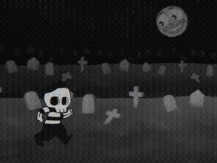
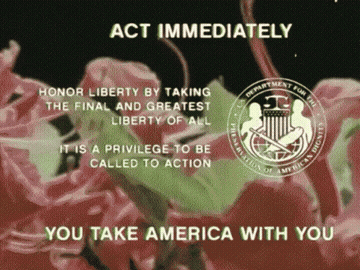
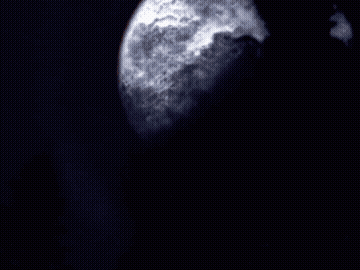
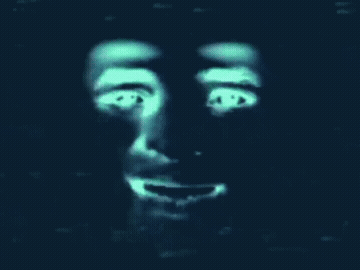

<div align="center">


# LOCAL 58 (WCLV-TV)
### TRANSMISSÃO ANALÓGICA DE EMERGÊNCIA — UHF 476.000 MHz
**Mason County, West Virginia • No Ar Desde 1934**

> *"O EVENTO METEOROLÓGICO CONTINUA ATÉ O AMANHECER.*  
> *EVITEM TODOS OS ESPELHOS.*  
> *NÃO OLHEM PARA O CÉU NOTURNO.*  
> *SE VOCÊ ESTIVER COM MEDO, NÓS OLHAREMOS JUNTOS."*

</div>

---

## 📺 O Incidente da Madrugada

Às **02:47 da madrugada**, a programação regular da **WCLV-TV (Canal 58 UHF)** foi violentamente interrompida. O transmissor principal da emissora, operando nas colinas isoladas de Mason County, West Virginia, começou a sofrer uma intrusão de sinal em larga escala.

A portadora analógica em 476.000 MHz foi sobrecarregada por anomalias que capturaram as fitas de transmissão e os protocolos da estação. Gravações arquivadas começaram a rodar sozinhas com desenhos infantis macabros, enquanto o sistema de contingência nacional assumiu a torre de controle.

<p align="center">
  
  
</p>

Os operadores da estação abandonaram a sala técnica em pânico. Na área dos telescópios de transmissão, as lentes automatizadas foram travadas em direção ao céu noturno, enquanto monitores de teste exibiam aberrações de reconhecimento facial através da estática de vídeo.

<p align="center">
  
  
</p>

Você acaba de assumir o **Console de Operações da WCLV-TV**. Diante de você está a interface de monitoramento analógico da estação — a única ponte técnica restante com o acervo de fitas magnéticas, o servidor de transmissão ao vivo, o repositório de automação da madrugada e as imagens de contenção.

Sua missão é sintonizar as frequências sequestradas, investigar os sistemas da emissora e decodificar os **4 sinais analógicos** antes do amanhecer.

---

## 🌒 Como Iniciar o Console

O console é operado através de uma **Interface de Terminal (TUI)** imersiva que monitora a telemetria da estação em tempo real. Recomenda-se trabalhar com **duas janelas de terminal** abertas:

1. **Terminal 1 (Monitor WCLV-TV):** Onde o console TUI exibirá os canais analógicos, status de transmissão e telemetria ao vivo.
2. **Terminal 2 (Terminal de Investigação):** Onde você executará seus comandos técnicos nos arquivos, repositórios e serviços.

---

### Opção 1: Via Docker Compose (Recomendado)

> Garante um ambiente isolado com todas as ferramentas pré-instaladas.

```bash
# Terminal 1 — Inicia o console de monitoramento analógico:
./run.sh
```

Em uma segunda janela de terminal, conecte-se ao ambiente de investigação:

```bash
# Terminal 2 — Abre o terminal de investigação dentro do container:
./run.sh shell
```

---

### Opção 2: Execução Direta no Host (Modo Local)

> Para rodar diretamente no seu sistema operacional (requer Go 1.21+):

```bash
# Terminal 1 — Compila e executa o console localmente:
./run.sh local

# Ou diretamente pelo binário compilado:
./desafio
```

No **Terminal 2**, acesse a pasta `workspace/` para iniciar suas investigações.

---

## 🌓 Operação do Console

No monitor da WCLV-TV, utilize os seguintes controles:

| Tecla / Atalho | Ação |
| :--- | :--- |
| `1` a `4` | Sintonizar diretamente os canais de transmissão 1 a 4 |
| `0` | Retornar ao canal CH 00 (Central de Operações da WCLV-TV) |
| `5` ou `f` | Abrir o **Decodificador de Sinais** para submeter uma `FLAG{...}` |
| `TAB` / `→` | Avançar para o próximo canal analógico |
| `Shift + TAB` / `←` | Retroceder para o canal analógico anterior |
| `↑` / `↓` ou `k` / `j` | Rolar o dossiê da transmissão atual |
| `PgUp` / `PgDn` | Rolar página inteira do canal |
| `h` | **Revelar próxima dica progressiva** (3 níveis pedagógicos disponíveis) |
| `r` | Re-escanear o ambiente (verifica repositórios, pastas e imagem Docker) |
| `?` | Abrir / Fechar o **Manual do Operador** integrado |
| `ESC` | Voltar ao canal anterior ou à Central |
| `q` ou `Ctrl + C` | Desligar o console da emissora |

> 🌕 **Dossiê, Pistas e Telemetria:** Toda a contextualização de cada sinal, caminhos de diretórios, rotas de rede ativas e instruções de investigação são apresentadas **diretamente dentro da TUI** ao sintonizar cada transmissão.

### Modo de Acessibilidade (Sem Estática/Glitch)

Caso prefira desativar os efeitos visuais de interferência analógica, ruído CRT e estática:
```bash
./run.sh local --no-glitch
```

---

## 🌖 Dicas Progressivas (Tecla `h`)

Para evitar frustrações mantendo o desafio estimulante, cada canal de transmissão conta com uma **escada de 3 dicas graduais**:
1. **Nível 1 (Direcionamento Conceitual):** Aponta a direção e o que analisar sem entregar a solução.
2. **Nível 2 (Padrão Técnico & Estratégia):** Explica as flags de comandos essenciais e conceitos chave.
3. **Nível 3 (Caminho Técnico Prático):** Apresenta comandos sugeridos prontos para execução no terminal.

Ao sintonizar qualquer canal de 1 a 4, pressione `h` para desbloquear a próxima pista.

---

## 🌗 Receptor de Sinais HTTP em Tempo Real (Porta 8058)

Durante a investigação da **Transmissão 2 (Skywatching)**, o console monitora todas as requisições enviadas ao transmissor local:
- **Painel Inferior de Log:** Exibe carimbo de data/hora, método HTTP colorido (`GET`, `POST`), rota, status code, latência e diagnóstico da transmissão.
- **Foco Lunar em Tempo Real:** Uma barra de sintonização telescópica reage dinamicamente aos seus testes de cURL conforme você avança pelos 4 estágios do sinal.
- **Cabeçalhos Oficiais da Emissora:** O servidor responde com `Server: WCLV-TV/1934`, `X-Station`, `X-Carrier`, `X-Signal-Step` e `X-Hint`. Use `curl -i` para inspecioná-los.

---

## 🌘 Decodificação de Sinais (Submissão de Flags)

Todas as chaves interceptadas durante a investigação seguem o formato:
```text
FLAG{...}
```

Para registrar um sinal recuperado:
1. Em qualquer tela, pressione a tecla **`f`** (ou selecione a opção 5).
2. Digite ou cole a chave encontrada e pressione **`ENTER`**. O decodificador aceita inclusive trechos de JSON colados diretamente do terminal.
3. O console confirmará a decodificação com a citação correspondente da emissora e atualizará o status em tempo real.

---

<div align="center">

*WCLV-TV • MASON COUNTY, WEST VIRGINIA • LIDERANÇA COMUNITÁRIA DESDE 1934*  
**REJOICE. OLHE PARA A LUA.**

</div>
